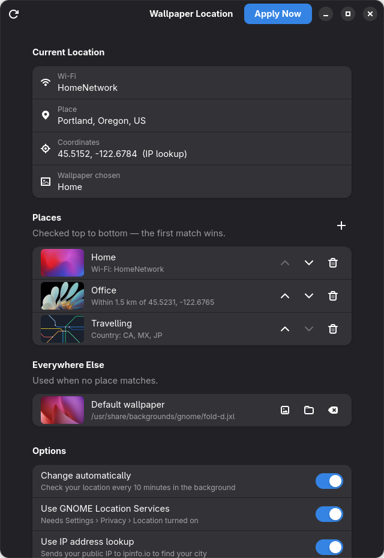
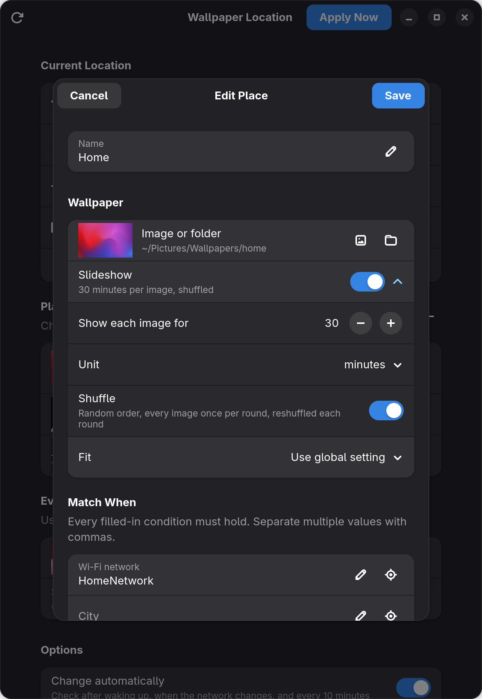

# Wallpaper Location

Change your GNOME wallpaper automatically based on where you are: one wallpaper at home, another at the office, something else when you're travelling.

A small GTK4 / libadwaita app plus a background timer. It's written in Python, uses only the standard library and PyGObject, and was built and tested on CachyOS with GNOME. It should work on any recent GNOME desktop.

<p align="center">
  
  
</p>

## Features

- **Match places by** Wi-Fi network name, city, region, country, or distance from a point on the map. Combine them however you like.
- **An image or a folder per place.** With a folder, a random image is picked from it, including its subfolders.
- **Slideshows.** Turn a folder into a slideshow and choose how long each image stays, in seconds, minutes or hours. Shuffle shows every image once per round, in a new random order each round. **Shuffle Slideshow Now** makes a new order straight away. GNOME plays the slideshow itself with a cross-fade, so it keeps going between location checks.
- **First match wins.** Reorder places to set priority, and set a fallback wallpaper for everywhere else, or leave it unset to keep your current wallpaper.
- **Tray icon** with *Next Wallpaper*, *Move to Trash* for weeding out images you don't want, when the wallpaper last changed, *Pause Slideshow*, a link to the image on screen, and a *Place* menu to pick a place by hand, overriding location detection until you switch back to *Automatic*.
- **Runs in the background.** It checks a few seconds after you wake the laptop or join a different network, and every 10 minutes and at login as a backup. It only changes the wallpaper when you've moved to a different place, so open the lid somewhere new and the right wallpaper is usually up by the time you've unlocked.
- **One-click helpers** fill in your current Wi-Fi, city or coordinates while you edit a place.
- **CLI too.** `wallpaper-location where` / `run` work without the GUI.

## How location is detected

Every check uses all of these sources and combines what each one finds:

| Source | Gives | Notes |
| --- | --- | --- |
| **Wi-Fi SSID** (`nmcli`) | Network name | Most reliable way to tell home from work. Fully offline. |
| **GNOME Location Services** (GeoClue) | Coordinates | Needs *Settings → Privacy → Location* turned on. |
| **IP lookup** ([ipinfo.io](https://ipinfo.io)) | City, region, country, rough coordinates | Sends your public IP to ipinfo.io. Turn it off in the app or config to stay offline. |

## Requirements

- GNOME 47 or newer (GTK 4, libadwaita ≥ 1.6)
- Python 3.11+ with PyGObject
- NetworkManager (for Wi-Fi matching), GeoClue (optional)
- For the tray icon: libappindicator (GTK 3) and the GNOME extension [AppIndicator and KStatusNotifierItem Support](https://extensions.gnome.org/extension/615/appindicator-support/)

On Arch / CachyOS, all of these are usually already installed with GNOME:

```bash
sudo pacman -S --needed python-gobject gtk4 libadwaita geoclue networkmanager \
    gtk3 libappindicator gnome-shell-extension-appindicator
```

## Install

```bash
git clone https://github.com/Radixtrator/WallpaperLocation.git
cd WallpaperLocation
./install.sh
```

This installs everything for your user only (no root):

- the app into `~/.local/share/wallpaper-location/`, with `wallpaper-location` and `wallpaper-location-gui` linked into `~/.local/bin/`
- a launcher entry, so **Wallpaper Location** shows up in the app grid
- the tray icon (`wallpaper-location-tray`), started now and at every login; switch it off with **Show tray icon** in the app
- the systemd user timer `wallpaper-location.timer` and the watcher `wallpaper-location-watch.service` (checks after waking up or changing networks), enabled and started
- an empty config at `~/.config/wallpaper-location/config.toml`, so your wallpaper isn't touched until you add places

To remove everything except your config:

```bash
./uninstall.sh
```

## Usage

Open **Wallpaper Location**, click **+** to add a place, pick a wallpaper and choose what it matches on. If you pick a folder, turn on **Slideshow** right below it and set how long each image stays. Changes are saved straight away. Click **Apply Now** to switch immediately; otherwise the background timer picks the change up within 10 minutes.

### Tray icon

| Menu item | What it does |
| --- | --- |
| **Current: *name*** | Opens the image on screen. **Show in Files** opens its folder. |
| **Last changed** | Date and time the image on screen last changed, including slideshow changes GNOME made on its own. |
| **Next Wallpaper** | Skips to the next image in a slideshow, or picks another random image from a folder. Middle-clicking the icon does the same. |
| **Move *name* to Trash** | Moves the image on screen to your Trash and shows the next one. Works only for places that use a folder. The file goes to the normal Trash, even from another drive or a cloud-sync folder (copied across, then deleted), so you can restore it from **Files › Trash**. If the folder syncs to the cloud, the file is removed there too. |
| **Pause Slideshow** | Keeps the current image on screen. Unpausing carries on from that image. The pause stays on when you move to another place, until you turn it off. |
| **Place** | *Automatic* chooses by location. Choosing a place keeps it, and the background timer, on that place wherever you are, until you switch back to *Automatic*. The app shows this too and has **Pick by Location Again**. |

From a terminal:

```bash
wallpaper-location where          # print what was detected
wallpaper-location run            # apply if the matched place changed
wallpaper-location run --force    # apply even if it didn't (re-rolls folder picks / reshuffles slideshows)
wallpaper-location run --dry-run  # show what would happen
wallpaper-location shuffle        # re-apply with a freshly shuffled slideshow order
wallpaper-location next           # skip to the next image
wallpaper-location trash          # move the image on screen to the Trash, show the next
wallpaper-location pause          # freeze the slideshow (resume to continue)
wallpaper-location watch          # stay running; check after waking up or changing networks
```

## Configuration

The GUI edits `~/.config/wallpaper-location/config.toml`, but it's plain TOML if you prefer editing by hand. See [`config.example.toml`](config.example.toml).

```toml
options = "zoom"          # zoom, scaled, centered, stretched, spanned, wallpaper

[detection]
geoclue = true
ip_lookup = true

[[rule]]                  # checked top to bottom; first match wins
name = "home"
ssid = "MyHomeWifi"       # or a list: ["Wifi-A", "Wifi-B"]
wallpaper = "~/Pictures/Wallpapers/home"   # file or folder
slideshow = 30            # folder only: minutes per image, or "45s" / "2h"
shuffle = true            # default: no repeats, new random order each round; false = name order

[[rule]]
name = "office"
lat = 45.5231
lon = -122.6765
radius_km = 1.5
wallpaper = "~/Pictures/Wallpapers/office.jpg"
options = "scaled"        # per-place override

[[rule]]
name = "travelling"
country = ["CA", "MX", "JP"]
wallpaper = "~/Pictures/Wallpapers/travel"

[default]                 # optional fallback
wallpaper = "/usr/share/backgrounds/gnome"
```

If a place has several conditions, **all** of them must match. Text matches ignore upper/lower case.

The wallpaper is set for both light and dark style (`picture-uri` and `picture-uri-dark`).

Slideshows are written as GNOME background XML files in `~/.local/state/wallpaper-location/` and replaced each time the wallpaper is applied. The folder is read when the place is applied, so images added later are picked up next time you move there or click **Apply Now**.

## Troubleshooting

- **"Geolocation disabled" in the log:** turn on *Settings → Privacy → Location*, or rely on Wi-Fi and IP lookup.
- **Check the background job:**
  ```bash
  journalctl --user -u wallpaper-location.service -u wallpaper-location-watch.service -n 20
  ```
- **No tray icon:** enable the *AppIndicator and KStatusNotifierItem Support* extension, then run `wallpaper-location-tray` or turn on **Show tray icon** in the app.
- **Lock screen shows the old place's wallpaper after waking up:** that's expected. GNOME's lock screen shows a blurred copy of the wallpaper you had when the laptop went to sleep. The check runs once the network reconnects, usually before you've finished unlocking. If you're not connected to any network, it waits 20 seconds after waking before checking.
- **"Change automatically" is greyed out:** the timer isn't installed. Run `./install.sh`.

## License

[MIT](LICENSE)
